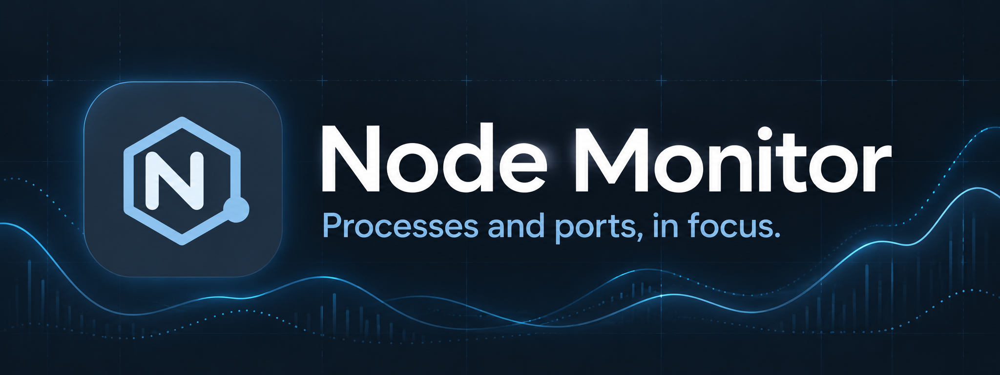

<p align="center"></p>

<p align="center">A small desktop app for finding Node.js processes and the ports they use.</p>

<p align="center"><a href="https://github.com/brunofunnie/node-monitor/releases/latest"><strong>Download for Linux or Windows</strong></a></p>

## Screenshot

<p align="center"></p>

## Get started

Download the latest release for **Linux** or **Windows**. On Linux, make the AppImage executable and open it:

```sh
chmod +x *.AppImage
./Node.Monitor-*.AppImage
```

On Windows, run the installer.

## Development

Install Node.js 22 or later, then run:

```sh
npm ci
npm start
```

Run the tests with `npm test`. To build a package for your current platform, run `npm run dist`.

## Features

- Find processes by name, PID, command, or port. Press `/` to focus the search.
- See Node processes, resident memory, parent processes, and listening TCP ports. The list refreshes every five seconds.
- Explore listening TCP ports from all processes; only Node processes can be stopped from the app.
- Recognize MCP commands and selected AI harnesses, including Claude Code, Codex, and Gemini CLI.
- Group processes by directory, stop a group with confirmation, and keep the app in the system tray.
- Choose English, Portuguese, or Spanish, and enable extra details or launch at login in settings.

On Windows, other processes' working directories are unavailable, so they cannot be grouped by directory. System permissions may limit available information or prevent stopping a process. Stopping a process does not automatically stop its children; on Linux, it sends SIGTERM. UDP ports are not shown.

Harness recognition depends on known paths and commands. Harness icons are loaded from the internet; their names remain visible offline.
